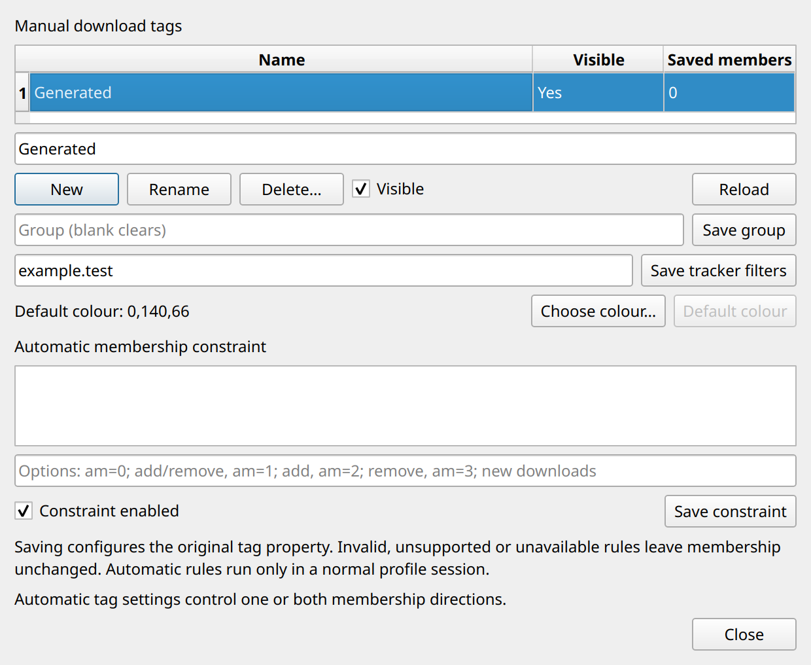

# Tracker tag configuration editor and actual saved-property producer

Native source `d3931c6e5aec916f42410d6af383a303958db846`, tree `65c7364fee0d390dcf13f08def4461dbc2b2e375`; original BiglyBT baseline remains
`cb8c6cb9bb97916cbc7e80338a017200ffc3e71f`.

The existing Tags manager now displays and saves tracker host filters. This is a
configuration property, not a tracker URL editor or announce operation. The
original generic property UI source replaces semicolons/literal spaces with
commas, splits, applies Java U0000..0020 trim to each entry and drops empties.
Native mirrors those separators/trim, preserves case/order/duplicates, and sends
null for blank input. Malformed/oversized saved data remains read only; unknown
text is never silently truncated into a new rule. The supported new field input
is bounded ASCII host text, consistent with the currently qualified matcher.
Old valid UTF8 may still be displayed and explicitly cleared/replaced. Unsupported
execution configurations remain subject to the existing normal effect policy.

An isolated helper executes the actual protected TagManagerImpl string-list
writer, with a generated config map and already-dirty flag as the inert dispatcher
boundary. No Core/client or actual manager config writer runs.64 generated
before/after nullable,empty,ordered,case,space,duplicate cases record the actual
changed flag and exact property presence/value. The Native typed property setter
compares all64 results, preserving unrelated record/root/member data. Null removes
pp.trackers; an explicit empty list stays distinct. Exact no-op keeps pristine
bytes and therefore existing Store lineage/generation/backup guarantees. Original
getConf may allocate an empty c in RAM on a no-op; Native does not persist that
incidental unsaved allocation. Invalid old field types and out-of-bound new names
refuse. The primitive stores configuration only and grants no membership effect.

The existing manual command enum appends SetTrackers without renumbering prior
commands. UI packets remain data/hints. Frontend and worker repeat input bounds;
the actual existing session/request/generation/OFD/primary/Store CAS remains
mandatory. Only a changed real durable setter result, after accepting its saved
snapshot, calls the private friend-only normal-worker property producer. No
caller property-event/newness flag or alternative writer is exposed. Offline,
disabled and invalid-lifetime modes do not activate automatic processing.

The private producer validates current owning Store snapshot/source and library,
primes/coalesces the actual property observer, and records that actual changed
setting. This handles a newly created tag whose old empty property was never
seen by the periodic observer. An unchanged setter produces no event. An empty-
member new tag starts at the addition pass, avoiding a pointless full-library
removal scan. Existing bounded32-pair/one-CAS owner, current effect/configuration,
source preimage, cancellation, uncertain-source and journal fences still govern
all automatic membership writes. Callback recording failure cannot reject or
lose the already-saved configuration. No fake torrent creation is introduced.

The widget test checks actual original-style delimiters and trim, typed property
intent, clear-to-null and invalid-encoding/field/configuration retention. A
synthetic offscreen capture below contains generated tag data only. The actual
isolated normal Host test creates a new tag, immediately saves filters, and
observes existing matching torrent membership via the changed-setting producer.
A NewOnly control remains empty. After a generated tracker source is changed to
a nonmatch, repeating the exact setter returns Unchanged and retains exact tag
bytes across actual ticks, proving no fabricated property event. A real null
clear then removes membership. Joined close and payload bytes are checked.
All networking/discovery/listen enable flags are off in the isolated profile;
no real profile or active client is opened.

Final GCC16 Release/C++23/Qt6.12.0 original64/core comparisons, all16 Store families,
new widget/actual setter, current legacy create/noop/stale/cancel/group/colour/
constraint/reopen consumers, current actual import/NewOnly/birth-dependent suite
and current bounded property owner pass. Static consumer targets are explicitly
rebuilt before accepting their tests. Exactly one application link follows the
focused checks. No unrelated full matrices, fresh sanitizer or real-profile run
is claimed. Agent self-review only.

This is a bounded setter/editor integration, not full property/action/tag parity.
Announce URL edit/sync producer, unsupported URL/Unicode matcher sources, birth
uncertainty repair, internal/peer/full census, named metrics and forced NewOnly
recursion remain current P08 work. No whole registry/F13/global upstream baseline
advances. No running client, real profile, protected SDK, daily/launcher, rollback
image or torrent resume state changed. Continue autonomously without a daily.
