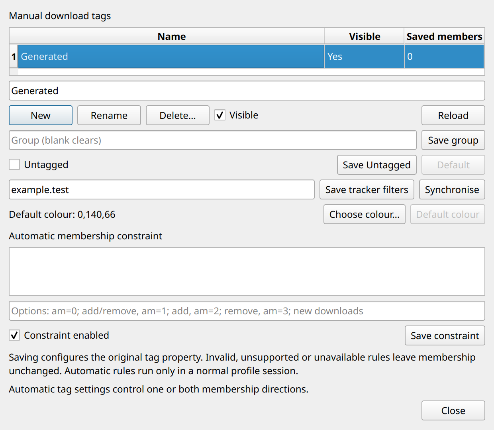

# Explicit saved tracker-filter synchronisation

Native source `fd1e0ab1261b14647ab2a6224dd6639065f7bca1`, tree `ec5d118427b8195a15bde9fa5e30fe45853a684c`; original baseline remains
`cb8c6cb9bb97916cbc7e80338a017200ffc3e71f`.

The existing2112 actual original tracker handler/sync cases and core event model
from [tracker source](../20261116-tracker-tag-source/REVIEW.md) are reused unchanged.
They distinguish explicit nonempty synchronisation from a changed property and
from startup: a nonempty saved filter reconciles current membership; empty sync
is a no-op, while clearing an actual previously nonempty setting reconciles its
members. No old Java matrix was unnecessarily rerun or claimed as new coverage.

The existing Tags manager now exposes Synchronise next to Save tracker filters.
It uses saved filters rather than unsaved editor text and submits an appended
SyncTrackers command through the normal session/request/generation protocol.
The backend validates its actual normal,enabled,current-library/Store owner.
Offline preview,closed lifetime,stale generation and unsupported saved filter
sources cannot create the action. Only the existing private property-event
admission accepts Changed (actual successful durable setter) or Sync (actual
explicit request). There is no public census/effect/newness flag.

Sync does not save configuration or advance its immediate command generation;
its result reports the accepted asynchronous work. Existing property work uses
normal bounded source/inventory/state/journal/CAS guards and can later save
membership. The real Store/current snapshot is checked at admission, and the
actual original tracker metadata is read when the owner processes its targets.
Source changes after a previously completed task require a genuine subsequent
change/sync; a configuration noop is not silently turned into sync. Empty sync
retains an independently assigned ordinary member. No new-download event is
created. Cancellation is checked before explicit queue acceptance; callbacks
for an already durable changed save retain the uncancelled default. The existing
UI/command cancellation controls remain; no fresh deterministic interruption
inside the short Sync preparation window is claimed.

Actual widget/normal/offline tests prove saved-filter request intent, pending
button state,empty/malformed/closed controls,no-op versus explicit sync after a
generated announce change,unchanged filter bytes,empty sync retaining the exact
manual-membership file,stale/offline rejection,no false new-only birth and
unchanged generated payload. The screenshot contains only generated data.

The final driver received SIGTERM during compilation while its locked build
survived. A successful incremental continuation verified all requested targets;
one actual application link marker is retained across the private interrupted/
continued log. No result from the interrupted supervisor alone is accepted.
Fresh current-source checks pass after the cancellation refinement: Sync widget/
Host,previous tracker setter/property owner,full actual new-download/dependency
suite,ordinary rules and existing command/reopen/stale/cancel families,Untagged
batch owner. GCC16 Release/C++23/Qt6.12 offscreen; no fresh sanitizer,live profile/
network or SWT qualification is claimed. Agent self-review only.

Tracker URL editing/live announce-change producer,unqualified URL spellings,
remaining tag sources and named metrics remain open. This is not full P08/F13 or
whole handler parity; integrated upstream baselines stay unchanged. Continue
remaining chapters autonomously. No running client,real profile,protected SDK,
daily/launcher or rollback image changed.
