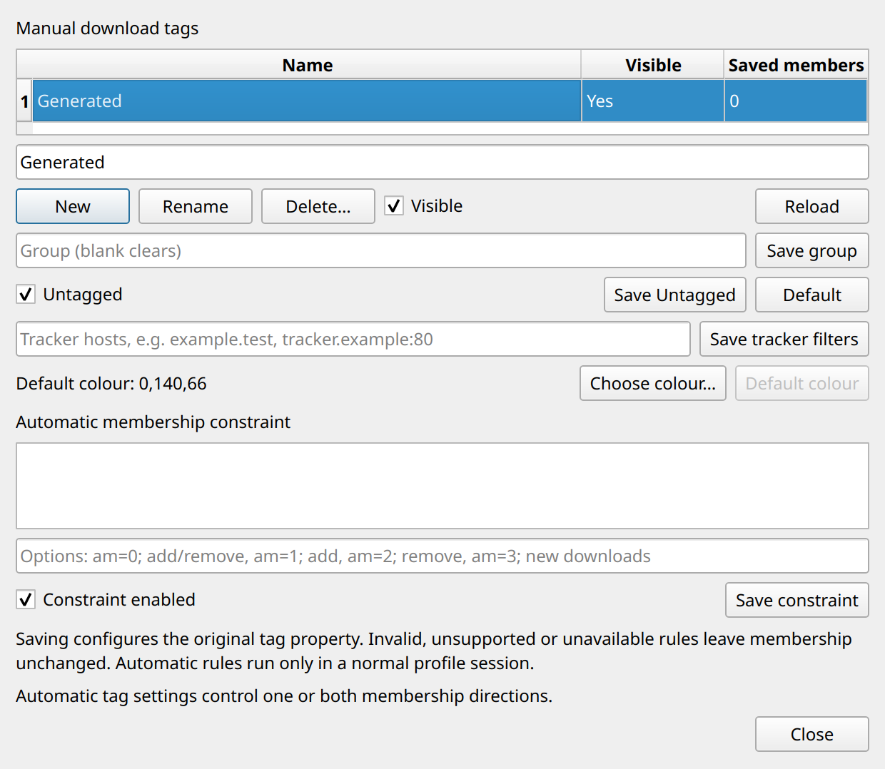

# Untagged settings and bounded current reconciliation

Native source `9fd1578e6876d391229cdd8f9f914fc4a97380b6`, tree `484e646358bd7a58742071c0d367146d09abcca4`; original baseline
`cb8c6cb9bb97916cbc7e80338a017200ffc3e71f` remains unchanged.

An isolated JDK17 helper invokes actual TagManagerImpl.readBooleanAttribute and
writeBooleanAttribute using inert config/dirty-dispatch boundaries.18 cases
cover absent,0,1,2,-1,4294967297 before values and nullable/false/true requests.
Only full Long1 reads true. Native typed writes and editor projections compare
all18 actual cases. Null removes just pp.untagged, false writes0, true writes1;
exact noops retain pristine bytes, unrelated data survives and malformed old
property types refuse rather than erase. No full Java Core/client or real
profile/network runs; callbacks beyond the prior handler oracle are not newly
claimed here.

The existing Tags manager includes Untagged enable/save/default controls. The
normal command enum and edit variant append their new alternatives, preserving
prior values. The Host uses existing session/request/generation/source/Store
checks. Only an actual changed successful durable setter calls the private
property producer. It carries the actual saved preimage and current snapshot,
so a true-to-false change is retained even before the first timer observation.
The producer cannot be called by a public UI-supplied census/newness flag. Noop
settings and property edits create no genuine new-download event. Unsupported
mixed automation/effects remain saved but cannot silently grant membership
execution. Default removes the property; a read-only/malformed row remains so.

Untagged reconciliation now batches multiple subjects in the existing one-CAS
membership API. Up to32 subjects/32 effects are processed per turn; all changes
for one subject stay together. A full subject that does not fit is deferred, and
a single subject needing more than32 effects is refused without publishing a
prefix. One primary inventory is used per turn, compact SHA256 preimages retain
each changed original state, and all touched primary states/inventory/source/
journals/cancellation are rechecked before the real CAS. Saved deltas reserve
all normal-dependent wakeups before commit. The own snapshot is acknowledged
so those deltas do not create a duplicate Untagged queue pass.

The actual35-subject test saves32 subjects with one generation advance and3
with the next, without touching original metadata, inventory or payload. This
is a deterministic reduction in required saved turns, not a measured live
startup speed claim. Existing unknown/positive/re-enable/33-effect/stale/cancel
owner regressions remain passing. Editor/normal-Host tests cover original read
projection, enable/disable/noop/default/stale commands, no false births and
payload preservation. The screenshot contains only generated synthetic data.

Explicit current static consumers cover existing tag commands/reopen, genuine
imports, tracker owner and tracker-filter widget/Host integration. Store16 and
18 value cases are unchanged after the batching-only worker revision and reuse
their already-green evidence. The application linked once after coherent
integration. GCC16 Release/C++23/Qt6.12 offscreen; no fresh sanitizer, SWT, real
profile/network or full startup performance qualification is claimed. Agent
self-review only.

Whole runtime registry/P08/F13 and integrated baselines remain in progress.
Remaining source censuses, handlers, metrics and forced-new-only dependencies
continue autonomously. No running client,real profile,protected SDK,daily/
launcher or rollback image changed.
