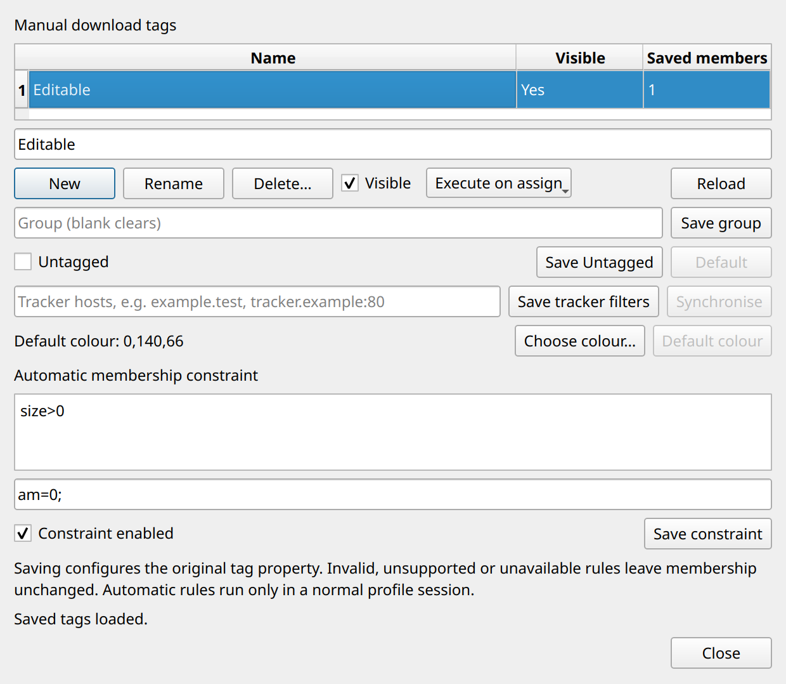

# Tag assignment action editor

Original `cb8c6cb9bb97916cbc7e80338a017200ffc3e71f`;Native `d6a687971c318fc63c4a05df92cdac7b4e814fa8`,tree `03de010dcf9312525137a39866ee348447c73cd4`.

The saved-tag editor exposes the seven qualified lifecycle actions as independent checked menu items in original SWT order:Start,Force Start,Cancel Force Start,Stop,Queue,Pause,Resume. A selection submits one typed action configuration command through the existing pending/session/generation/Store CAS path. It edits only the exact pp.<action> integer and preserves other flags,unknown data,names and membership. Unsupported action IDs and malformed selected types refuse rather than guessing. Saving settings neither creates assignment receipts nor replays existing members. Current normal-owner packets may offer supported lifecycle-tag membership through the ordinary tag context menu;offline hints remain read-only for active effects. Hints are data,not authority;actual Host/source/identity/provider/command guards remain mandatory. The separate filesystem-only chip batch owner does not gain active action execution in this change.

Actual original TagBase.setActionEnabled and actual manager Boolean/Long writer were invoked for126 cases across the seven actions,missing/default/exact/noncanonical/large/signed-boundary prior values and both requested Booleans. Objects are allocated with inert manager configuration;only metadata-listener delivery is replaced by a recording override. No original tag constructor,live Core,resolver or actual membership actor is claimed. Original always emits one metadata notification,including equal-value setters. Native compares exact persisted Long values and preserves idempotent physical no-op behavior. Noncanonical false2 is rewritten0;selected malformed-type refusal is an explicit Native conservative boundary outside this normal-integer comparison. The current binary consumes all126 setter cases plus the retained689 actual getter cases.

Lifecycle property changes are excluded from constraint compilation/configuration versions alongside qualified display metadata. A warmed real worker test confirms changing these flags does not reapply exhausted rules or create new-download events. Current normal/offline Host tests change flags on stored members without starting downloads;the independent menu test verifies original order,one-flag intent,checked state,pending disable/reply restore and normal-versus-offline membership hints. Existing current normal actual assignment/batch/source/store,window/constraint and shared commands pass. A controlled generated-profile UI capture was inspected and is included below;no user capture is used.

The initial native build caught a Node constructor mismatch;the explicit typed constructor was corrected before acceptance. The original helper also required its subclass constructor signature to match the pinned original;the constructor itself is not run. The new UI test initially counted an already-consumed QSignalSpy entry;its expectation was corrected and only that test target was rebuilt. The accepted full application build and126+689 reference checks were retained. Final GCC16 Release/C++23/Qt6.12.0 application and affected checks pass. No new sanitizer,real profile run,SDK,daily image or launcher change is claimed. Remaining chip/multiple-subject execution,other action families and whole F13/global migration remain open. Agent review only;continue autonomously.
